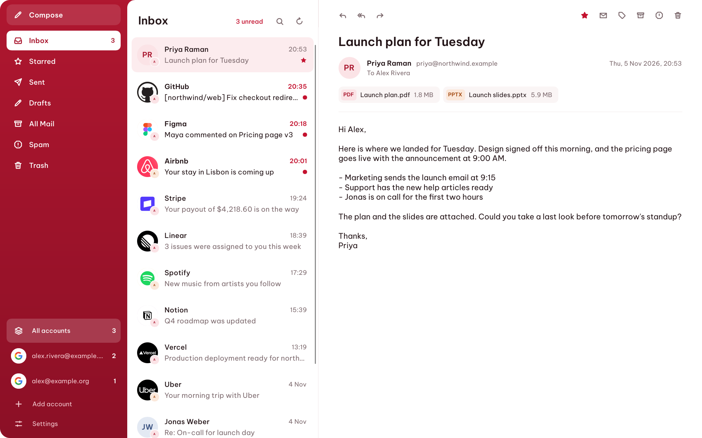
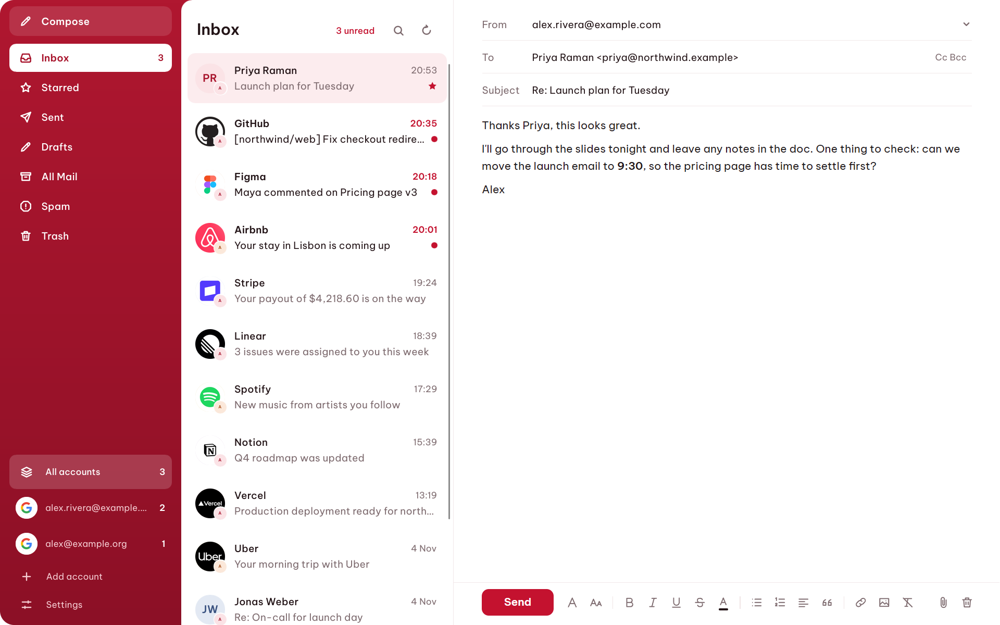

  

<h1 align="center">mailfunction</h1>

  <b>Email that keeps up with you.</b> 
  A fast, private desktop mail client for Gmail on Windows.

  <a href="https://github.com/NooberCong/mailfunction/releases/latest/download/mailfunction-setup.exe"><b>Download for Windows</b></a>
  &nbsp;·&nbsp;
  <a href="#sign-in">Get started</a>
  &nbsp;·&nbsp;
  <a href="#keyboard">Keyboard</a>
  &nbsp;·&nbsp;
  <a href="docs/Development.md">Development</a>

  
  
  

  <picture>
    <source media="(prefers-color-scheme: dark)" srcset="docs/images/inbox-dark.png">
    
  </picture>

## Why mailfunction

- **Instant.** Your mail lives on your PC, so opening, searching and triaging never wait on the network.
- **Every account, one inbox.** See all your Gmail accounts together, or switch between them with a keystroke.
- **Private by default.** Remote images stay blocked until you allow them, so senders can't quietly track when you read their mail.
- **Hard to fool.** Only senders Gmail has verified get a logo, and a forged From line gets no trust.
- **Works offline.** Read, write and organize anywhere. Your changes reach the server when you're back.
- **Undo send.** Changed your mind? You have ten seconds to call a message back.
- **Made for the keyboard.** Move through your whole inbox without reaching for the mouse.

## Write beautifully

Format your text, add pictures and attachments, and choose which account to send from. Light and dark themes follow Windows, or you can pick your own.

  <picture>
    <source media="(prefers-color-scheme: dark)" srcset="docs/images/compose-dark.png">
    
  </picture>

## Install

| | |
| --- | --- |
| **[Installer](https://github.com/NooberCong/mailfunction/releases/latest/download/mailfunction-setup.exe)** | Recommended. Adds mailfunction to the Start menu, with no administrator rights needed. |
| **[Executable](https://github.com/NooberCong/mailfunction/releases/latest/download/mailfunction.exe)** | One file to run from anywhere, with nothing to install. |

You'll need 64-bit Windows 10 or 11, and [WebView2](https://developer.microsoft.com/microsoft-edge/webview2/), which Windows 11 already includes.

Releases aren't code signed yet, so Windows may warn you the first time. Choose **More info**, then **Run anyway**.

## Sign in

mailfunction doesn't have a shared Google sign-in yet, so you connect it with your own free Google client. It takes about five minutes, once:

1. In [Google Cloud](https://console.cloud.google.com/), create a project and enable the **Gmail API**.
2. Set the OAuth app to **External** and **In production**, then create a **Desktop** client.
3. Download the client JSON and save it as `%USERPROFILE%\.config\mailfunction\google-client.json`.
4. Open mailfunction and sign in. Google will say the app is unverified, which is expected for a client you made yourself.

## Keyboard

| Key | Action | | Key | Action |
| --- | --- | --- | --- | --- |
| `j` `k` | Next, previous | | `c` | Compose |
| `e` | Archive | | `r` | Reply |
| `#` | Delete | | `Ctrl+Enter` | Send |
| `/` | Search | | `z` | Undo |
| `Ctrl+0` | All accounts | | `Ctrl+1` to `9` | One account |
| `Ctrl+,` | Settings | | `?` | Every shortcut |

## Your data

There are no mailfunction servers. Your mail is stored on your PC and synced directly with Google, and your sign-in is kept in Windows Credential Manager. Removing an account deletes its local mail and revokes its access.

Two things do reach beyond Google. Sender logos come from each sender's own domain, which tells it your IP address, and you can turn them off in Settings. Images you choose to load can tell a sender you opened their mail.

## Development

mailfunction is written in Rust with [Slint](https://slint.dev) and WebView2. See [Development](docs/Development.md) to build it, run the tests or learn how it works.

The pictures above show made-up mail. Product names and logos belong to their owners.
